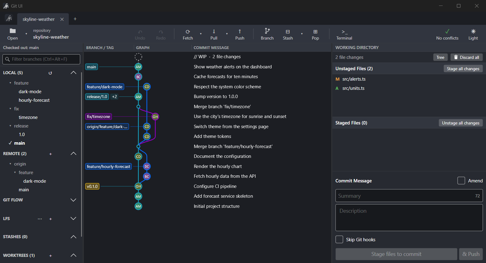
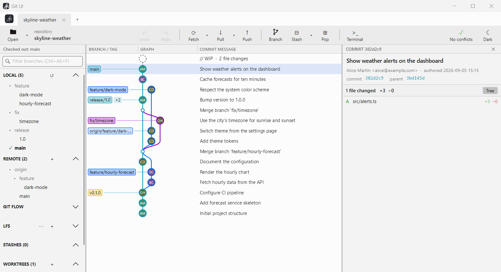
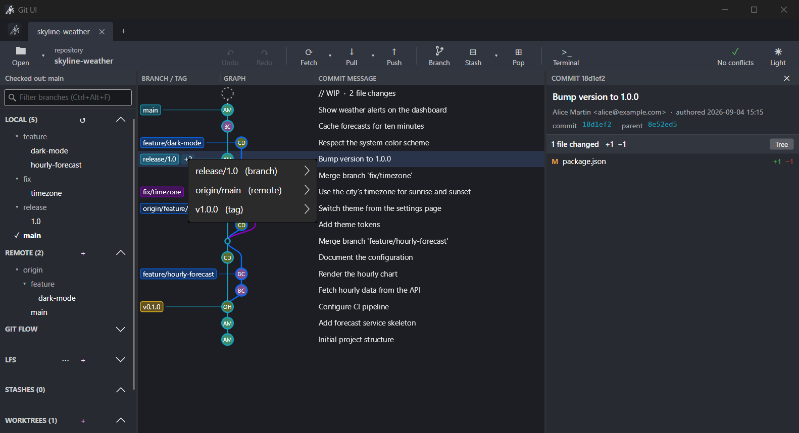
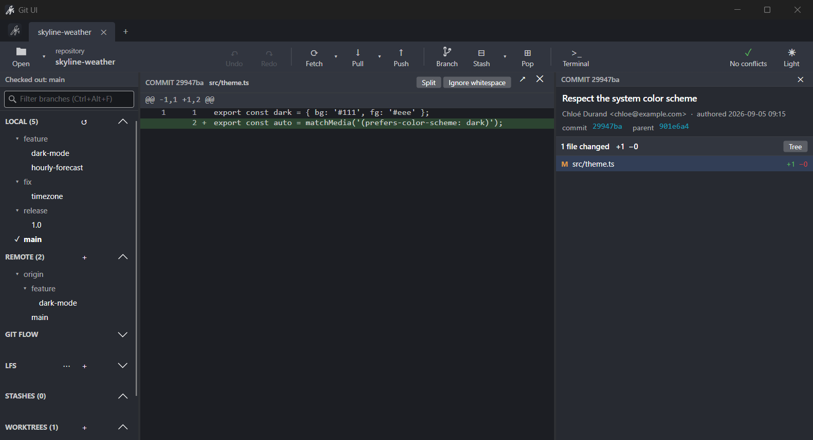

<div align="center">


# Git UI

**A fast, keyboard-friendly desktop Git client for Windows, Linux and macOS.**

Inspired by the best graphical Git clients, written in C# with Avalonia.


[](LICENSE)
[](https://github.com/Deve1ne/git-ui/releases/latest)

**[Download](https://github.com/Deve1ne/git-ui/releases/latest)** · [All releases](https://github.com/Deve1ne/git-ui/releases) · [Build from source](#run-from-source)



</div>

---

## Highlights

- **A commit graph you can read.** Colored lanes, author avatars, branch and tag badges, a `// WIP`
  row for uncommitted work. Search commits, Ctrl+click two commits to compare them.
- **Drag a branch onto another** to merge, rebase, fast-forward, push or reset, like you would in
  your head.
- **Always up to date.** Changes made from a terminal, an IDE or another Git client show up on
  their own: new refs refresh everything, file edits refresh only the staging area, and build
  output in ignored folders is left alone.
- **Conflicts without fear.** A three-way merge tool, automatic resolution of the trivial hunks,
  and an indicator that predicts conflicts with the target branch before you merge.
- **Everything is one keystroke away.** A command palette (`Ctrl+P`) for every action and branch.

## Features

| Area | What you get |
|---|---|
| **History** | Commit graph, commit details, file history and blame, reflog, undo / redo of the last operations, bisect |
| **Changes** | Stage and unstage files, hunks or lines, unified or split diffs, ignore whitespace, discard, amend, skip hooks, apply a patch |
| **Branches** | Create, checkout, rename, delete, merge, rebase, interactive rebase, cherry-pick, revert, reset, tags, stashes, worktrees, submodules |
| **Remotes** | Fetch (prune, tags, submodules), pull (merge, rebase, fast-forward only), push, auto-fetch, tags moved on the server handled gracefully |
| **Hosting** | GitHub, GitLab, Azure DevOps and Bitbucket accounts: pull requests in the side panel, create a PR, clone from your account |
| **Workflow** | Git Flow (feature, release, hotfix), Git LFS, commit signing (GPG / SSH), identity profiles for work and personal repositories |
| **Comfort** | Tabs with session restore, integrated terminal, light and dark themes, zoom, keyboard navigation everywhere |

## Screenshots

<table>
  <tr>
    <td width="50%"><p align="center"><sub>Light theme</sub></p></td>
    <td width="50%"><p align="center"><sub>Several refs on one commit: click <code>+N</code> to reach any of them</sub></p></td>
  </tr>
  <tr>
    <td colspan="2"><p align="center"><sub>Commit details and diff</sub></p></td>
  </tr>
</table>

## Download

Grab the installer for your system from the **[latest release](https://github.com/Deve1ne/git-ui/releases/latest)**:

| System | File | Install |
|---|---|---|
| Windows 10 / 11 | `GitUi-<version>-win-x64.msi` | Double-click. Per-user install, no admin rights, Start menu and desktop shortcuts |
| Debian / Ubuntu | `gitui_<version>_amd64.deb` (or `_arm64`) | `sudo apt install ./gitui_<version>_amd64.deb`, then `gitui` |
| macOS | `GitUi-<version>-macos-arm64.zip` (Apple Silicon) or `-macos-x64.zip` (Intel) | Unzip, right-click `Install Git UI.command` > *Open* |

Each package ships its own .NET runtime; only [Git](https://git-scm.com/) needs to be installed.
The packages are not code-signed yet, so Windows SmartScreen and macOS Gatekeeper ask for a
confirmation the first time.

## Getting started

### Requirements

- [Git](https://git-scm.com/) installed and on the `PATH` (Git UI writes through the Git command line)
- To build: the [.NET 8 SDK](https://dotnet.microsoft.com/download/dotnet/8.0)

### Run from source

```bash
git clone https://github.com/Deve1ne/git-ui.git
cd git-ui
dotnet run --project src/GitUi.Presentation
```

### Build the installers

```bash
python packaging/package.py                  # every target
python packaging/package.py win deb-amd64    # only some of them
```

| Target | Output |
|---|---|
| Windows | `GitUi-<version>-win-x64.msi`, per-user install, no admin rights |
| Debian / Ubuntu | `gitui_<version>_amd64.deb`, `gitui_<version>_arm64.deb` |
| macOS | `GitUi-<version>-macos-arm64.zip` (Apple Silicon), `-macos-x64.zip` (Intel) |

Each package ships a self-contained .NET runtime. See [packaging/README.md](packaging/README.md) for details.

Releases are built by GitHub Actions ([release.yml](.github/workflows/release.yml)): pushing a tag
such as `v0.2.0` builds every installer and publishes them as a GitHub release.

## Keyboard shortcuts

| Shortcut | Action | | Shortcut | Action |
|---|---|---|---|---|
| `Ctrl+P` | Command palette | | `Ctrl+Enter` | Commit |
| `Ctrl+L` | Fetch all remotes | | `Ctrl+Shift+S` | Stage all |
| `Ctrl+B` | Create a branch | | `Ctrl+Z` / `Ctrl+Y` | Undo / redo |
| `Ctrl+F` | Search commits | | `Ctrl+T` / `Ctrl+W` | New / close tab |
| `Ctrl+J` / `Ctrl+K` | Toggle side panels | | `Ctrl+,` | Preferences |

## Architecture

Clean Architecture, four layers, each in its own project:

```
src/
  GitUi.Domain           graph layout algorithm, pure domain types
  GitUi.Application      use cases and services, abstractions over Git
  GitUi.Infrastructure   LibGit2Sharp for reading, the git CLI for writing, settings, hosting APIs
  GitUi.Presentation     Avalonia UI (MVVM with CommunityToolkit), Skia-rendered commit graph
tests/                   xUnit + NSubstitute, unit and integration tests against real repositories
```

Reading goes through LibGit2Sharp for speed; every write goes through the `git` command line so
hooks, credentials, signing and your configuration behave exactly as in a terminal.

```bash
dotnet test
```

## License

[MIT](LICENSE) © Dimitri Even

---

<div align="center"><sub>Made by <a href="https://github.com/Deve1ne">Deve1ne</a></sub></div>
